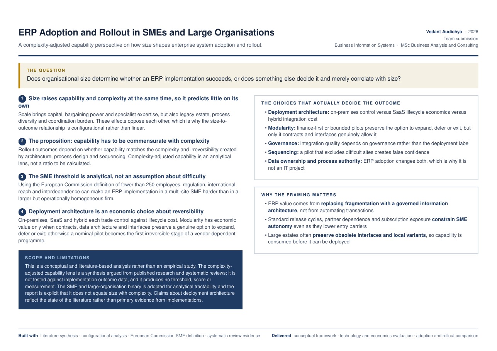

# ERP Adoption in SMEs and Large Organisations: Size, Complexity and Capability

> Does organisational size determine whether an ERP implementation succeeds, or does something else decide it and merely correlate with size?

| | |
|---|---|
| **Role** | Team submission |
| **Context** | Business Information Systems · MSc Business Analysis and Consulting, University of Strathclyde · 2026 |
| **Type** | Conceptual, literature-based analysis |
| **Methods** | Literature synthesis · configurational analysis · European Commission SME definition · systematic review evidence |

## Key findings

1. **Size raises capability and complexity at the same time, so it predicts little on its own.** Scale brings capital, bargaining power and specialist expertise, but also legacy estate, process diversity and coordination burden. The relationship is configurational, not linear.
2. **The proposition: capability has to be commensurate with complexity.** Rollout outcomes depend on whether capability matches the complexity and irreversibility created by architecture, process design and sequencing. "Complexity-adjusted capability" is an analytical lens, not a ratio.
3. **The SME threshold is analytical, not an assumption about difficulty.** Using the EC definition (fewer than 250 employees), regulation, international reach and interdependence can make an ERP rollout in a multi-site SME harder than in a larger but homogeneous firm.
4. **Deployment architecture is an economic choice about reversibility.** On-premises, SaaS and hybrid each trade control against lifecycle cost. Modularity has value only when contracts, data architecture and interfaces preserve a genuine option to expand, defer or exit.

## The choices that actually decide the outcome

| Choice | Why it matters |
|---|---|
| Deployment architecture | On-premises control vs SaaS lifecycle economics vs hybrid integration cost |
| Modularity | Finance-first or bounded pilots keep options open only if contracts and interfaces allow it |
| Governance | Integration quality depends on governance, not the deployment label |
| Sequencing | A pilot that excludes difficult sites creates false confidence |
| Data ownership and process authority | ERP changes both, which is why it is not an IT project |

## Limitations

- Conceptual and literature-based, not an empirical study. The lens is not tested against implementation outcome data and produces no threshold, score or measurement.
- The SME versus large-organisation binary is used for analytical tractability; it does not equate size with complexity.
- Claims about deployment architecture reflect the literature rather than primary evidence.

## Files

- [`one-pager.pdf`](one-pager.pdf) — one-page project summary

---
**Vedant Audichya** · MSc Business Analysis and Consulting, University of Strathclyde · [LinkedIn](https://www.linkedin.com/in/vedantaudichya) · [All projects](https://github.com/Vedant-Au)
